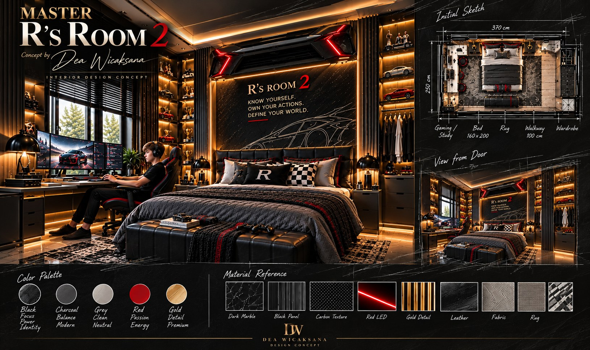
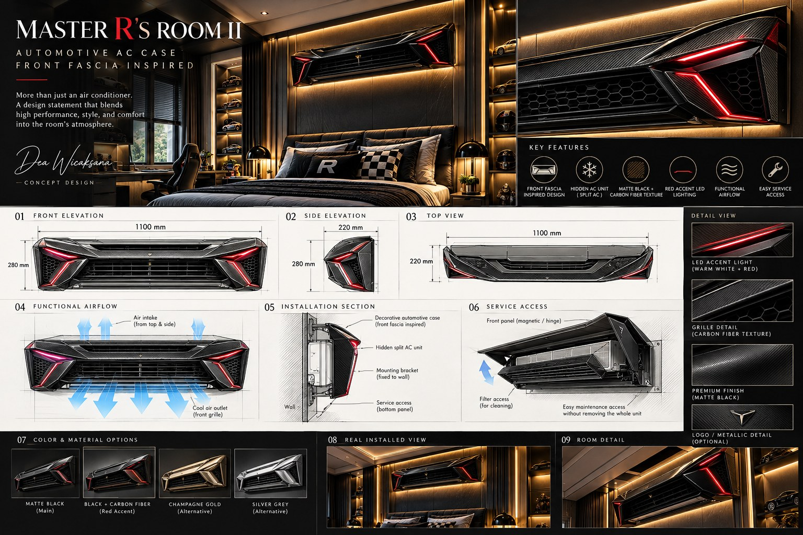
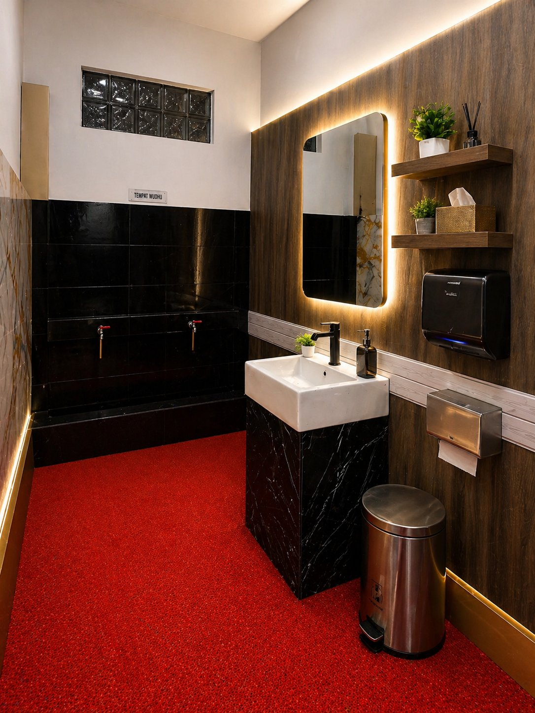
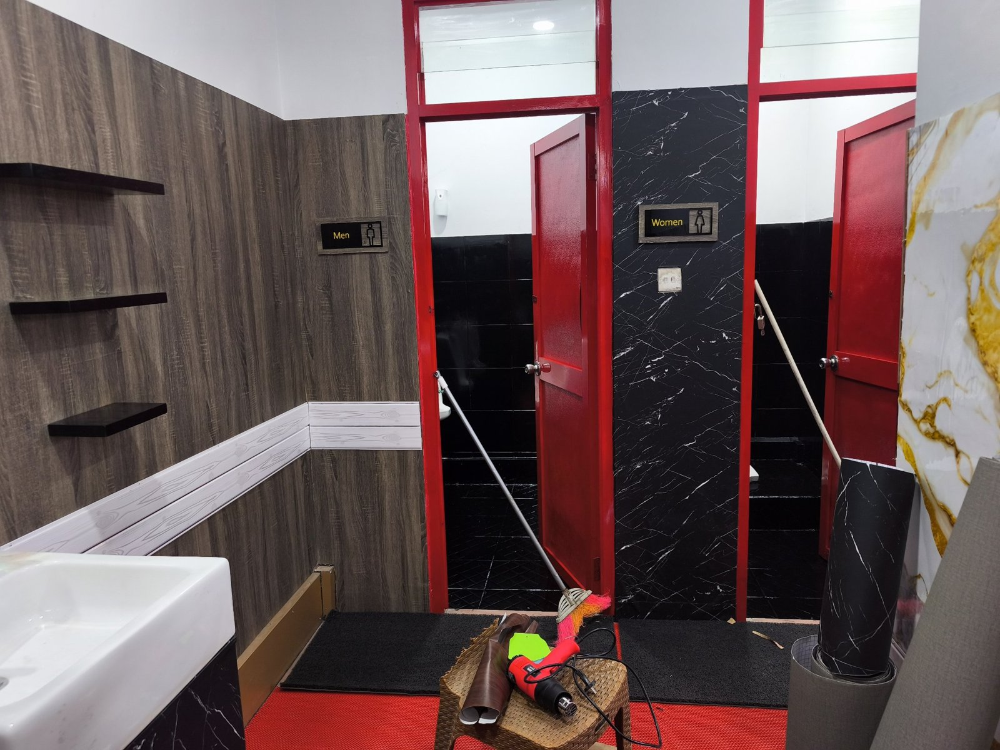
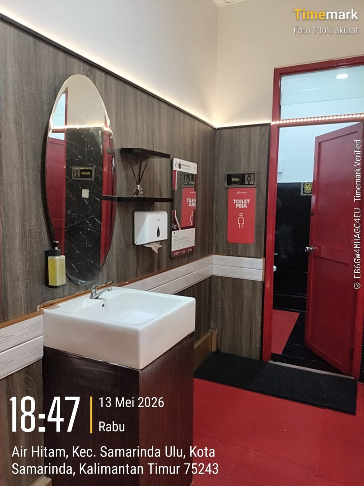

# Dea Wicaksana — Concept Designer · DW Studio

*Designing spaces. Elevating lifestyles.*

Portfolio of **Dea Wicaksana**, an Indonesian concept designer from Bali and founder of **DW Studio**.
Interior and spatial design concepts for homes, children's rooms and hospitality, shaped by environmental psychology.

## Selected work

- [PRIMAL 1 — Private Residence](https://deawicaksana.id/2026/10/27/primal-1-private-residence/) — for Mr. Danylo Weiss · 🎬 [concept art reel](https://www.instagram.com/reel/DfI6B0hhyOZ/)
- [MGL Hostel and Suite — Puerto Vallarta, México](https://deawicaksana.id/2026/10/16/mgl-hostel-and-suite-puerto-vallarta/)
- [DW Émeraude Family Hotel & Suite](https://deawicaksana.id/2026/10/18/dw-emeraude-family-hotel-suite/)
- [Master R's Room I](https://deawicaksana.id/2026/10/17/master-rs-room/)
- [Master R's Room II](https://deawicaksana.id/2026/10/29/master-rs-room-ii/)
- [Maison D'Art — Where Art Meets Living](https://deawicaksana.id/maison-dart-where-art-meets-living/)
- [DW Peach Royale Castle Suite](https://deawicaksana.id/peach-royale-castle-suite/)
- [Toilet Renovation — SPBU DODO 64.751.13, Samarinda](https://deawicaksana.id/redesign-toilet-spbu-modern-elegant-warm-concept/) — built project

More work on [deawicaksana.id](https://deawicaksana.id).

## Master R's Room II

📍 Surabaya, Indonesia

A bedroom concept for a young man who loves cars: black, charcoal and red with gold detail, a gaming and study corner, display shelves for model cars and trophies, and an air conditioner hidden inside a custom automotive-inspired case.

*Know yourself. Own your actions. Define your world.*

🎬 Video: [Master R's Room II on Instagram](https://www.instagram.com/reel/DeUWcV9hfTQ/)

*Concept visualization.* Read more: [Master R's Room II on deawicaksana.id](https://deawicaksana.id/2026/10/29/master-rs-room-ii/)

## Toilet Renovation — SPBU DODO 64.751.13, Samarinda

📍 SPBU DODO 64.751.13, Jl. Kadrie Oening, Samarinda, Kalimantan Timur · May 2026

**EN**
Gas station toilets are often seen as dirty and neglected. This one-week renovation, completed ahead of a Pertamina assessment, set out to change that perception. The idea was a red carpet experience: warm lighting, a clean and welcoming atmosphere, and a space that makes every visitor feel valued. To keep it that way, the toilet is closed every Wednesday for routine maintenance, a consistent schedule that keeps the standard from slipping.

**ID**
Toilet SPBU sering dianggap jorok dan tidak terawat. Renovasi satu minggu menjelang penilaian Pertamina ini dibuat untuk mengubah cara pandang itu. Idenya adalah suasana red carpet: pencahayaan hangat, ruang yang bersih dan ramah, serta kesan bahwa setiap pengunjung dihargai. Agar standarnya tetap terjaga, toilet ditutup setiap hari Rabu untuk pemeliharaan rutin secara konsisten.

*Designed by Dea Wicaksana. Realized in May 2026.*

*Concept, work in progress, and the completed result (13 May 2026).* Read more: [Toilet Renovation SPBU DODO 64.751.13 on deawicaksana.id](https://deawicaksana.id/redesign-toilet-spbu-modern-elegant-warm-concept/)

## Links

- 🌐 Portfolio: https://deawicaksana.id
- 🔗 Links: https://deawicaksana.link
- 📸 Instagram: https://www.instagram.com/deawicaksana16/
- ▶️ YouTube: https://www.youtube.com/@DeaWicaksana16

— Dea Wicaksana
